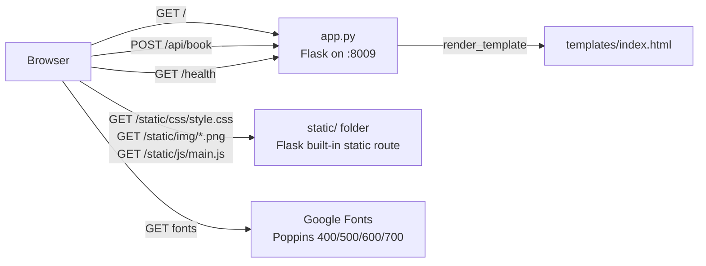

# Design Document: FitnessCh Landing Page

## Overview

The FitnessCh Landing Page is a single-view, desktop-first hero page reproduced from a reference screenshot (≈1024×720, dark theme). A minimal Flask application (`app.py`) serves one Jinja template and a small set of static assets on `0.0.0.0:8009`. There is no database and no session state. The only dynamic behavior is a `POST /api/book` endpoint the "BOOK A CLASS" button calls via `fetch`, plus a `/health` probe.

The design centers on three decisions:

1. **Pixel positioning via a fixed design canvas.** The reference is 1024px wide. On desktop viewports, the page content lives in a `.stage` element 1024px wide × 100vh tall, horizontally centered, with children absolutely positioned using the pixel coordinates from the requirements. This gives a faithful copy at the reference size without fighting fluid layout. On narrow viewports (<1024px) a media query switches `.stage` to a vertical flex stack.
2. **All colors as CSS custom properties** (Color_Tokens) in `:root`, so the palette is in one place and testable by inspection.
3. **Image blending via CSS mask**, not a pre-edited PNG, so any placeholder photo blends into the background along its bottom and side edges.

Environment: Python 3.12 venv at `/home/rishab/Videos/RapX/venv` (Flask not yet installed). Target language for all code is Python (backend) and HTML/CSS/vanilla JS (frontend).

## Architecture



Request flow:
- `GET /` → `index()` → `render_template("index.html")` → HTML with `url_for('static', ...)` links.
- Static files are served by Flask's default static handler (`static_folder="static"`, `static_url_path="/static"`). No custom route is needed; Flask sets `Content-Type` from file extension.
- `POST /api/book` → `book()` → `jsonify({"message": "..."})`.
- `GET /health` → `health()` → `jsonify({"status": "ok"})`.
- Any other path → Flask default 404.

## File Structure

```
RapX/
├── app.py                      # Flask app; app.run(host="0.0.0.0", port=8009, debug=True)
├── requirements.txt            # Flask>=3,<4
├── README.md                   # setup + run instructions, mentions http://localhost:8009
├── templates/
│   └── index.html              # single Jinja template
├── static/
│   ├── css/
│   │   └── style.css           # tokens, stage layout, section styles, narrow fallback
│   ├── js/
│   │   └── main.js             # BOOK A CLASS fetch handler
│   └── img/
│       ├── model.png           # placeholder model photo (user may replace)
│       ├── avatar-1.png
│       ├── avatar-2.png
│       └── avatar-3.png
└── tests/
    └── test_app.py             # Flask test-client tests
```

## Components and Interfaces

### Flask application (`app.py`)

```python
from flask import Flask, render_template, jsonify, request

app = Flask(__name__)  # static_folder="static", template_folder="templates" by default

@app.get("/")
def index():
    return render_template("index.html")

@app.get("/health")
def health():
    return jsonify(status="ok")

@app.post("/api/book")
def book():
    payload = request.get_json(silent=True) or {}
    name = str(payload.get("name", "")).strip()
    message = f"Thanks{', ' + name if name else ''}! Your class request has been received."
    return jsonify(message=message)

if __name__ == "__main__":
    app.run(host="0.0.0.0", port=8009, debug=True)
```

Design notes:
- `get_json(silent=True)` means a missing or malformed body never raises; the endpoint always returns 200 with a non-empty `message` (Req 11.5).
- `app` is module-level so tests can import it and use `app.test_client()`.
- Debug mode is on for local development per the user's request; README notes to turn it off for anything public.

### Template (`templates/index.html`)

Semantic skeleton; every element gets a class that maps to a design section.

```html
<!doctype html>
<html lang="en">
<head>
  <meta charset="utf-8">
  <meta name="viewport" content="width=device-width, initial-scale=1">
  <title>FitnessCh — Reach Your Best Shape for Life</title>
  <link rel="preconnect" href="https://fonts.googleapis.com">
  <link rel="preconnect" href="https://fonts.gstatic.com" crossorigin>
  <link href="https://fonts.googleapis.com/css2?family=Poppins:wght@400;500;600;700&display=swap" rel="stylesheet">
  <link rel="stylesheet" href="{{ url_for('static', filename='css/style.css') }}">
</head>
<body>
  <main class="stage">
    <header class="nav">
      <a class="logo" href="#">Fitness<span>Ch</span></a>
      <nav class="nav__links" aria-label="Primary">
        <a href="#">Home</a><a href="#">About</a><a href="#">How It Works</a>
        <a href="#">Results</a><a href="#">Testimonials</a>
      </nav>
    </header>

    <h1 class="headline">Reach Your Best<br>Shape for Life</h1>

    

    <aside class="social" aria-label="Social links">
      <a href="#" aria-label="YouTube"><svg …/></a>
      <a href="#" aria-label="Facebook"><svg …/></a>
      <a href="#" aria-label="Instagram"><svg …/></a>
      <span class="social__line" aria-hidden="true"></span>
    </aside>

    <p class="tagline">Get stronger, leaner, and more energized with custom fitness and nutrition coaching that fits your lifestyle</p>

    <section class="stats" aria-label="Happy clients">
      <div class="stats__avatars">
        
        
        
      </div>
      <p class="stats__text"><span class="stats__num">1.2k</span><span class="stats__label">Happy Clients</span></p>
    </section>

    <div class="cta">
      <button class="btn-book" type="button">Book a Class</button>
      <p class="cta__msg" role="status" aria-live="polite"></p>
    </div>
  </main>
  <script src="{{ url_for('static', filename='js/main.js') }}" defer></script>
</body>
</html>
```

Social icons are inline SVGs (YouTube, Facebook, Instagram glyph paths, `fill="currentColor"`) so they inherit white and need no icon-font dependency.

### Stylesheet (`static/css/style.css`)

#### Color and typography tokens

```css
:root {
  --bg:            #0B0B14;
  --bg-edge:       #000000;
  --text:          #FFFFFF;
  --text-muted:    #C9C9D1;
  --headline-top:  #FFFFFF;
  --headline-bot:  #B5B5BD;
  --accent:        #2CFF2C;   /* button */
  --accent-ring:   #2DFF2D;   /* avatar rings */
  --btn-text:      #000000;
  --line:          #FFFFFF;

  --font-heading: "Poppins", "Inter", system-ui, sans-serif;
  --font-body:    "Poppins", "Inter", system-ui, sans-serif;
}
```

#### Stage and background

```css
html, body { margin: 0; height: 100%; }
body {
  background: var(--bg) radial-gradient(ellipse at center, var(--bg) 55%, var(--bg-edge) 100%);
  color: var(--text); font-family: var(--font-body);
  overflow: hidden;              /* no scrollbar on desktop */
}
.stage {
  position: relative; width: 1024px; height: 100vh; margin: 0 auto; overflow: hidden;
}
```

#### Desktop positions (≥1024px)

| Element | Selector | Position / size | Z |
|---|---|---|---|
| Nav row | `.nav` | `top:36px; left:60px; right:60px; display:flex; justify-content:space-between; align-items:center` | 4 |
| Logo | `.logo` | 28px / 700 / white; `.logo span` weight 500 for the stylized "Ch" | – |
| Links | `.nav__links a` | 14px, `--text-muted`, `gap:40px`, `text-decoration:none`; hover → `--text` | – |
| Headline | `.headline` | `top:110px; left:0; right:0; text-align:center; font:700 104px/0.95 var(--font-heading); letter-spacing:-0.03em; background:linear-gradient(180deg,var(--headline-top),var(--headline-bot)); -webkit-background-clip:text; background-clip:text; color:transparent` | 1 |
| Model | `.model` | `top:200px; left:50%; transform:translateX(-50%); width:400px; height:calc(100vh - 200px); object-fit:cover; object-position:top; mask-image` (see below) | 2 |
| Social | `.social` | `left:68px; top:285px; transform:translateX(-50%)`; flex column; icons 20px with `gap:50px` so centers land at 295/365/435; `.social__line` 1px×60px, `margin-top:20px` (top at 465px) | 3 |
| Tagline | `.tagline` | `left:697px; top:355px; max-width:260px; font-size:14px; line-height:20px; color:var(--text-muted)` | 3 |
| Stats | `.stats` | `left:60px; top:590px` | 3 |
| Avatars | `.stats__avatars img` | 48×48, `border-radius:50%`, `border:2px solid var(--accent-ring)`, `margin-left:-16px` (first child 0) | – |
| Stat text | `.stats__num` 40px/700 heading font; `.stats__label` 14px; both in a flex row with `align-items:baseline; gap:10px` | – |
| Button | `.btn-book` | `left:755px; top:625px; width:150px; height:44px; border-radius:22px; background:var(--accent); color:var(--btn-text); font:700 13px var(--font-body); text-transform:uppercase; border:0; box-shadow:0 0 24px color-mix(in srgb, var(--accent) 55%, transparent)` | 3 |

Model image mask (Req 4.4), combining a vertical and a horizontal fade:

```css
.model {
  -webkit-mask-image:
    linear-gradient(to bottom, #000 0%, #000 55%, transparent 100%),
    linear-gradient(to right, transparent 0%, #000 18%, #000 82%, transparent 100%);
  -webkit-mask-composite: source-in;
  mask-image: /* same */;
  mask-composite: intersect;
}
```

If `model.png` fails to load, `` with empty `alt` renders nothing visible and is absolutely positioned, so no other element moves (Req 4.6).

#### Narrow fallback (<1024px)

```css
@media (max-width: 1023px) {
  body { overflow: auto; }
  .stage { width: 100%; height: auto; min-height: 100vh; display: flex; flex-direction: column;
           gap: 32px; padding: 24px 20px; box-sizing: border-box; }
  .stage > * { position: static; transform: none; }
  .nav { flex-wrap: wrap; gap: 16px; }
  .headline { font-size: 48px; order: 1; }
  .model    { width: 100%; max-width: 400px; height: auto; margin: 0 auto; order: 2; }
  .tagline  { order: 3; max-width: none; }
  .stats    { order: 4; }
  .cta      { order: 5; }
  .social   { display: none; }
}
```

### Client script (`static/js/main.js`)

```js
document.querySelector(".btn-book")?.addEventListener("click", async () => {
  const msg = document.querySelector(".cta__msg");
  try {
    const res = await fetch("/api/book", {
      method: "POST",
      headers: { "Content-Type": "application/json" },
      body: JSON.stringify({}),
    });
    const data = await res.json();
    msg.textContent = data.message ?? "Request received.";
  } catch {
    msg.textContent = "Could not reach the server. Please try again.";
  }
});
```

`.cta__msg` is positioned directly beneath the button (`top: 675px; left: 755px; width: 150px; font-size: 12px; color: var(--text-muted)`).

### Placeholder images

`static/img/model.png` and the three avatars are generated at scaffold time with a tiny Python/Pillow-free script using Flask's dependencies only: simplest is to write minimal valid PNGs via the standard library (`zlib` + `struct`) — a solid dark-red-to-black vertical gradient 400×520 for the model and 48×48 flat grey squares for avatars. The README tells the user to drop in the real photo at the same path. Using a CSS mask means the real photo will blend without further editing.

## Data Models

The feature is stateless; the only structured data crosses the `/api/book` boundary.

```python
# Request (optional, all fields optional)
BookRequest = {"name": str}          # any other keys ignored

# Response (always 200)
BookResponse = {"message": str}      # non-empty

# Health response
HealthResponse = {"status": "ok"}
```

Color tokens are the other "data" in the system and are enumerated in the Stylesheet section above.

## Error Handling

| Situation | Handling |
|---|---|
| `POST /api/book` with no body, non-JSON body, or wrong `Content-Type` | `request.get_json(silent=True)` returns `None`; treated as `{}`; still returns 200 with default message. |
| `POST /api/book` with `name` of non-string type | Coerced with `str()`; no 500. |
| Unknown URL | Flask default 404 (HTML). No custom handler needed. |
| `GET /api/book` (wrong method) | Flask default 405. |
| `static/img/model.png` missing | Browser receives 404 for the image; `` is invisible; absolute positioning means no layout shift. |
| Google Fonts unreachable | `font-family` falls back to Inter → system-ui → sans-serif; `display=swap` avoids invisible text. |
| `fetch` failure in browser | Caught; status text shown under the button. |
| Port 8009 already in use | `app.run` raises `OSError`; README documents how to free the port or change it. |

## Testing Strategy

### PBT assessment

Property-based testing is **not** applied to this feature. The work is UI rendering (pixel positions, colors, typography) plus three trivial Flask routes with no transformation logic. There is no "for all inputs X, P(X)" statement that would find bugs that two or three concrete examples would not. The closest candidate, `/api/book` tolerating arbitrary bodies, is covered adequately by three example cases (no body, valid JSON, malformed JSON). Accordingly, this design has no Correctness Properties section.

### Unit / integration tests (`tests/test_app.py`, pytest + Flask test client)

Backend:
- `GET /` → 200, body contains `FitnessCh`, `Reach Your Best`, `Shape for Life`, `BOOK A CLASS` (case-insensitive), `/static/css/style.css`, `/static/img/model.png`. (Req 11.3, 12.4, 2.1, 3.1, 8.1)
- `GET /health` → 200, JSON `{"status": "ok"}`. (Req 11.4)
- `POST /api/book` with `{}`, with `{"name": "Sam"}`, with no body, with invalid JSON → all 200, `message` non-empty string; the "Sam" case contains "Sam". (Req 11.5)
- `GET /does-not-exist` → 404. (Req 11.6)
- `GET /static/css/style.css` → 200, `text/css` in Content-Type. (Req 12.2)
- `GET /static/img/model.png` → 200, `image/png` in Content-Type. (Req 12.3)
- `app.py` source contains `port=8009` and `host="0.0.0.0"` (static check, since starting the real server is out of scope for unit tests). (Req 11.2)

Static content checks (string/regex assertions on files, cheap and deterministic):
- `style.css` defines `--bg: #0B0B14`, `--accent: #2CFF2C`, `--accent-ring: #2DFF2D`, `--text-muted: #C9C9D1`, `--headline-bot: #B5B5BD`. (Req 1.1, 1.4, 8.2, 7.2)
- `style.css` contains `font-size: 104px`, `line-height: 0.95`, `letter-spacing: -0.03em`, `width: 400px`, `width: 150px`, `height: 44px`, and a `@media (max-width: 1023px)` block with `font-size: 48px`. (Req 3.3, 4.2, 8.3, 10.3)
- `index.html` nav links appear in order Home, About, How It Works, Results, Testimonials; social `aria-label`s appear in order YouTube, Facebook, Instagram. (Req 2.3, 5.1, 5.5)
- `requirements.txt` contains `Flask`; `README.md` contains `8009` and `python app.py`. (Req 13.1–13.3)

### Manual visual verification

Visual fidelity (exact pixel placement, gradient appearance, glow) is verified by running `python app.py`, opening `http://localhost:8009` at a 1024×720 window, and comparing against the reference screenshot. This is a checkpoint step for the user, not an automated test.

### Test tooling

- `pytest` added to a `requirements-dev.txt` (kept out of runtime `requirements.txt`).
- Run: `/home/rishab/Videos/RapX/venv/bin/python -m pytest -q`.
